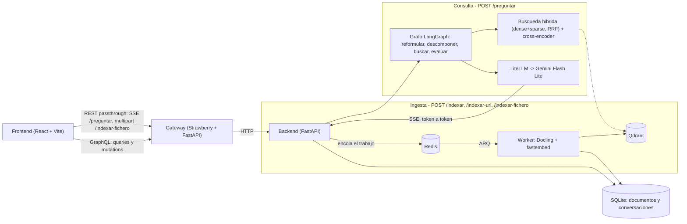

# Agent4U

> Sistema RAG (Retrieval-Augmented Generation) en español: ingesta estructurada de documentos, recuperación híbrida (densa + BM25) sobre Qdrant con reordenado por cross-encoder, y generación orquestada con un grafo de LangGraph — con las fuentes de cada respuesta a la vista y sets de preguntas propios para evaluar el pipeline.


## Visión general

Agent4U recibe documentos (PDF/DOCX), los convierte en fragmentos con estructura semántica, los indexa en una base vectorial y responde preguntas en lenguaje natural mostrando, junto a la respuesta, los fragmentos de los que sale (documento, páginas y encabezados). El objetivo del proyecto es doble: servir como un RAG realmente usable sobre documentación propia, y como banco de pruebas para decisiones de diseño de RAG (chunking, embeddings, distancia de similitud, evaluación) documentadas y medidas, no solo intuidas.

El proyecto tiene tres piezas: un backend FastAPI + Qdrant + Redis/ARQ, un gateway GraphQL que es el único punto de entrada del frontend, y un frontend React + Vite que sirve a la vez un sitio editorial sobre el sistema (`/`) y la aplicación del agente (`/app`). Este README describe honestamente qué está implementado, qué está a medias y qué no está: es la única documentación del proyecto.

## Índice

- [Características](#características)
- [Arquitectura](#arquitectura)
- [Stack tecnológico](#stack-tecnológico)
- [Estructura del proyecto](#estructura-del-proyecto)
- [Puesta en marcha](#puesta-en-marcha)
- [Variables de entorno](#variables-de-entorno)
- [Uso de la API](#uso-de-la-api)
- [Cómo funciona el pipeline](#cómo-funciona-el-pipeline)
- [Evaluación del sistema](#evaluación-del-sistema)
- [Calidad y desarrollo](#calidad-y-desarrollo)
- [Flujo de trabajo con Git](#flujo-de-trabajo-con-git)
- [Roadmap y traza de mejoras](#roadmap-y-traza-de-mejoras)
- [Licencia](#licencia)

## Características

- **Ingesta estructurada de PDF/DOCX** con [Docling](https://docling-project.github.io/docling/): conserva títulos, secciones y tablas en lugar de extraer texto plano sin orden de lectura.
- **Chunking semántico** vía `HybridChunker`, atado al mismo tokenizer que el modelo de embeddings — evita fragmentos que rompan el límite de tokens del modelo.
- **Filtrado de ruido**: descarta chunks que son solo cabecera/pie de página o demasiado cortos para aportar contexto.
- **Recuperación híbrida**: vector denso multilingüe (`multilingual-e5-large`, 1024 dimensiones, distancia coseno) y vector disperso BM25 (`Qdrant/bm25`) sobre Qdrant, fusionados con RRF y reordenados con un cross-encoder (`jina-reranker-v2-base-multilingual`). Los nombres de los modelos se configuran en un único sitio, `app/core/config.py`.
- **Payload enriquecido por chunk**: documento de origen, páginas, encabezados y fecha de indexación — es lo que la interfaz muestra como fuentes de cada respuesta.
- **Ingesta idempotente**: los IDs son deterministas (`uuid5` sobre el id del documento y la posición del fragmento), así que reindexar el mismo documento no duplica datos, y dos documentos con un fragmento idéntico no comparten punto.
- **Grafo de consulta con [LangGraph](https://langchain-ai.github.io/langgraph/)** (`app/rag/grafo/`): reformula la pregunta con el historial, la descompone en subconsultas si trata de varios temas, busca cada una, fusiona los resultados, evalúa si bastan y, si no, reescribe la consulta y vuelve a buscar.
- **Generación en streaming** vía [LiteLLM](https://docs.litellm.ai/) (Gemini Flash Lite por defecto, intercambiable por otro proveedor sin tocar código) con un system prompt que prohíbe salirse del contexto recuperado y pide **no** citar dentro del texto: las fuentes se envían aparte (evento SSE `fuentes`) y la interfaz las muestra junto a la respuesta.
- **Sets de preguntas de evaluación**: 25 preguntas fijas de 5 tipos distintos, contra un corpus de prueba de 11 documentos. El arnés que las puntuaba no está hoy en el repositorio (ver [Evaluación del sistema](#evaluación-del-sistema)).

## Arquitectura

El frontend solo habla con el gateway — nunca directamente con el backend. El gateway traduce GraphQL a HTTP contra el backend y reenvía sin tocar los dos flujos que no caben en una respuesta JSON: el streaming SSE de `/preguntar` y la subida multipart de `/indexar-fichero`.



El endpoint `POST /indexar*` responde `202` en cuanto el trabajo queda en la cola de Redis — no bloquea la petición. El worker (`backend/app/worker/`, proceso aparte) lo recoge, convierte el documento con Docling, genera los embeddings y marca el resultado final en la base de datos; el frontend sondea `GET /trabajos/{job_id}` (vía el gateway) hasta que termina. Backend y worker usan los mismos modelos de embeddings (`fastembed`, configurados en `app/core/config.py` y construidos en `app/rag/modelos.py`) y la misma colección de Qdrant, pero son procesos distintos: cada uno carga su propia copia de los modelos, una sola vez al arrancar. Docling solo lo carga el worker; la API carga además el cross-encoder y el grafo.

## Stack tecnológico

| Área | Tecnología | Estado |
|---|---|---|
| Backend / API | Python 3.12 + FastAPI (uvicorn) | Hecho |
| Gestión de dependencias | uv | Hecho |
| Gateway | GraphQL (Strawberry) + FastAPI, único punto de entrada del frontend | Hecho |
| Cola de indexación | Redis + ARQ, worker en proceso aparte | Hecho |
| Ingesta / parsing | Docling — PDF/DOCX con estructura, también URLs | Hecho |
| Ingesta / parsing | Trafilatura — limpieza de HTML adicional desde URLs | Planificado |
| Chunking | Docling `HybridChunker` + tokenizer de e5-large | Hecho |
| Embeddings densos | fastembed — `intfloat/multilingual-e5-large` (1024 dim) | Hecho |
| Embeddings dispersos | fastembed — `Qdrant/bm25` | Hecho, integrados en la búsqueda |
| Base vectorial | Qdrant (vector denso con distancia coseno + vector disperso con IDF) | Hecho |
| Recuperación | Híbrida (dense + sparse con RRF) + reordenado con cross-encoder | Hecho |
| Generación | LiteLLM, por defecto `gemini/gemini-flash-lite-latest` | Hecho |
| Generación | Streaming de respuesta por SSE en `/preguntar` | Hecho |
| Orquestación agéntica | LangGraph (`app/rag/grafo/`) | Hecho |
| Validación / config | Pydantic v2 + pydantic-settings, prefijo por servicio (`APP_`, `GATEWAY_`) | Hecho |
| Frontend | React + Vite + TypeScript, chat con streaming, ingesta, conversaciones | Hecho |
| Contenedores | Docker Compose — qdrant, redis, api, worker, gateway; frontend (nginx) en el perfil `frontend` | Hecho |
| Lint / tipado | `ruff` en verde (backend y gateway); `mypy` configurado y no en verde | Parcial (ver [deuda técnica](#deuda-técnica-conocida)) |
| Tests | pytest (backend + gateway), vitest + Playwright (frontend) | Hecho — ver [Calidad y desarrollo](#calidad-y-desarrollo) |
| Evaluación RAG | Sets de preguntas propios (25 preguntas); el arnés que las puntuaba no está en el repo | Parcial |
| Evaluación RAG | RAGAS | Planificado / opcional |
| CI/CD | GitHub Actions | Parcial — solo backend (`.github/workflows/backend.yml`) |

## Estructura del proyecto

```text
Agent4U/
├── backend/
│   ├── app/
│   │   ├── api/
│   │   │   ├── lifespan.py        # carga embedders, cross-encoder y grafo, y abre Qdrant/Redis, una sola vez al arrancar
│   │   │   ├── main.py            # la app FastAPI: CORS y montaje de los routers
│   │   │   ├── schemas.py         # modelos Pydantic de entrada y salida
│   │   │   └── routers/           # un fichero por área: health, query, indexation, jobs, documents, conversations
│   │   ├── core/
│   │   │   ├── config.py          # Settings vía pydantic-settings, prefijo APP_
│   │   │   └── exceptions.py      # excepciones de dominio, que los routers traducen a códigos HTTP
│   │   ├── db/
│   │   │   ├── models/            # tablas SQLAlchemy: documentos y conversaciones
│   │   │   ├── crud/              # acceso a datos, sin lógica de negocio
│   │   │   └── session.py         # motor y SessionLocal
│   │   ├── rag/
│   │   │   ├── grafo/             # el grafo de LangGraph: nodos y composición
│   │   │   ├── modelos.py         # construye embedders, cross-encoder, Docling y chunker desde Settings
│   │   │   ├── vectorization.py   # troceado con Docling y subida por lotes a Qdrant
│   │   │   ├── retrieval.py       # búsqueda híbrida (densa + dispersa) y reordenado
│   │   │   ├── generation.py      # reformular, reescribir y descomponer la consulta con el LLM
│   │   │   ├── prompt.py          # las plantillas y la construcción del contexto
│   │   │   └── streaming.py       # traducción a eventos SSE y persistencia de la respuesta
│   │   ├── services/              # orquestación: consulta, documentos, cola de indexación y la función única de indexación (worker y scripts)
│   │   └── worker/                # proceso ARQ aparte: recoge trabajos de Redis y los indexa
│   ├── tests/
│   │   ├── unit/ integration/ api/  # la suite de pytest, espejo de los módulos que cubre
│   │   ├── evaluation/            # material manual de evaluación (no lo recolecta pytest)
│   │   └── README.md              # qué hay en cada nivel y cómo se lanza
│   ├── Dockerfile
│   ├── pyproject.toml
│   └── uv.lock
├── gateway/
│   ├── app/
│   │   ├── main.py                # FastAPI: CORS, router GraphQL y proxy REST
│   │   ├── config.py              # Settings vía pydantic-settings, prefijo GATEWAY_
│   │   ├── clients/                # BackendClient (Protocol) + HttpBackendClient (adaptador httpx)
│   │   ├── schema/                 # tipos, Query y Mutation de Strawberry
│   │   └── proxy.py               # POST /preguntar (SSE) y /indexar-fichero (multipart), sin GraphQL
│   ├── tests/
│   ├── Dockerfile
│   └── pyproject.toml
├── frontend/
│   ├── src/
│   │   ├── routes.ts              # el mapa de rutas: de aquí salen nav, pie, migas y las pruebas
│   │   ├── app/                   # la aplicación del agente (/app)
│   │   ├── sitio/                 # el sitio editorial (/), con sus páginas y datos
│   │   ├── features/              # chat, documentos, conversaciones, ajustes, comandos, salud
│   │   └── shared/                # api (incluye el cliente GraphQL), hooks, lib, ui y tokens de estilo
│   ├── pruebas-e2e/               # Playwright: Chromium y WebKit, con un backend+gateway falso
│   ├── herramientas/              # comprobaciones propias del bundle de producción
│   ├── despliegue/nginx.conf      # SPA con fallback y proxy de /api/ al gateway
│   └── Dockerfile                 # build de producción: Node compila, nginx sirve
├── docker-compose.yml             # qdrant, redis, api, worker, gateway (+ frontend con --profile frontend)
└── README.md
```

**Convención de nombres**: identificadores de dominio y lógica de negocio en español (`obtener_documentos`, `ColaIndexacion`, `useIngesta`); nombres ligados a una convención externa, en inglés (`Document` como modelo SQLAlchemy, `Query`/`Mutation` de GraphQL, `BackendClient`). No es una mezcla arbitraria — se mantiene así a propósito en los tres servicios.

## Puesta en marcha

**Requisitos**: Docker Desktop (o Docker Engine), [uv](https://docs.astral.sh/uv/) y Node.js 20+ instalados.

```bash
docker --version
uv --version
node --version
```

### Con Docker Compose (recomendado)

Levanta los 5 servicios de `docker-compose.yml` — qdrant, redis, api, worker, gateway — de una vez:

```bash
git clone https://github.com/Pepe-alms/AGENT4U.git
cd AGENT4U
cp backend/.env.example backend/.env   # y rellena APP_GEMINI_API_KEY
APP_GEMINI_API_KEY=tu-clave docker compose up --build
```

- Backend: `http://localhost:8000/docs` (Swagger UI)
- Gateway: `http://localhost:8080/graphql` (GraphQL Playground)
- Qdrant: `http://localhost:6333/dashboard`

Para levantar también el frontend en su build de producción (nginx sirviendo el bundle y proxeando `/api/` al gateway):

```bash
APP_GEMINI_API_KEY=tu-clave docker compose --profile frontend up --build
# http://localhost:3000
```

Para desarrollar el frontend es mejor no usar Docker y tener recarga en caliente:

```bash
cd frontend
cp .env.example .env   # VITE_API_URL apunta al gateway, no al backend
npm install
npm run dev
# http://localhost:5173
```

### Sin Docker, servicio a servicio

Útil para desarrollar un solo servicio sin reconstruir la imagen entera.

```bash
# Qdrant y Redis, lo mas simple es Docker igual
docker compose up -d qdrant redis

# Backend (necesita Qdrant y Redis arriba)
cd backend
uv sync
cp .env.example .env   # y rellena APP_GEMINI_API_KEY
uv run uvicorn app.api.main:app --reload
uv run python -m app.worker   # el worker es un proceso aparte, en otra terminal

# Gateway (necesita el backend arriba)
cd gateway
uv sync
uv run uvicorn app.main:app --reload --port 8080

# Frontend (necesita el gateway arriba)
cd frontend
npm install
npm run dev
```

La primera ejecución de la API y del worker descarga los modelos de ML (fastembed en los dos, Docling solo en el worker) desde Hugging Face Hub (requiere red); a partir de ahí quedan cacheados en local (`~/.cache/huggingface/`) y el pipeline corre offline.

## Variables de entorno

| Variable | Prefijo | Obligatoria | Valor por defecto | Descripción |
|---|---|---|---|---|
| `APP_GEMINI_API_KEY` | `APP_` | Sí | — | API key de [Google AI Studio](https://aistudio.google.com/), usada por LiteLLM para llamar a Gemini |
| `APP_QDRANT_URL` | `APP_` | No | `http://localhost:6333` | URL del servidor Qdrant |
| `APP_LLM_MODEL` | `APP_` | No | `gemini/gemini-flash-lite-latest` | Identificador de modelo que recibe LiteLLM |
| `APP_MODELO_DENSO`, `APP_DIMENSION_DENSA`, `APP_MODELO_DISPERSO`, `APP_IDIOMA_DISPERSO`, `APP_MODELO_RERANKER`, `APP_CHUNK_MAX_TOKENS` | `APP_` | No | ver `backend/.env.example` | Modelos de embeddings, reranker y troceado. API y worker deben ver los mismos valores; cambiar el modelo denso o el disperso obliga a reindexar |

La lista completa, con el resto de opciones (Redis, subidas, límites de indexación), está comentada en `backend/.env.example`.

```bash
# backend/.env
APP_GEMINI_API_KEY=tu-api-key-de-google-ai-studio
APP_QDRANT_URL=http://localhost:6333
APP_LLM_MODEL=gemini/gemini-flash-lite-latest
```

## Uso de la API

Con el servidor arrancado, FastAPI expone el contrato completo en `/docs` (Swagger UI) y `/redoc`. Además de los dos que se describen aquí hay `POST /indexar-url`, `POST /indexar-fichero` (subida `multipart`), `GET /trabajos/{job_id}`, `GET`/`DELETE /documentos`, `/conversaciones`, `GET /ajustes` y `/health`. El frontend no llama a estos endpoints directamente: pasa por el gateway.

### `POST /indexar`

Encola la indexación de un fichero que ya está en disco. Espera una ruta **accesible por el proceso del worker**; para subir el fichero desde el cliente está `POST /indexar-fichero`.

```bash
curl -X POST http://localhost:8000/indexar \
  -H "Content-Type: application/json" \
  -d '{
        "file_path": "/ruta/absoluta/al/documento.pdf",
        "type": "pdf"
      }'
```

Responde `202` en cuanto el trabajo está en la cola (`409` si esa ruta ya está indexada, `429` si la cola está llena):

```json
{ "job_id": "3f2b…", "status": "en-cola" }
```

> El nombre del documento no se manda: se deriva de la propia ruta (`os.path.basename`), así que no hay dos fuentes de verdad que puedan discrepar.

### `POST /preguntar`

Pasa la pregunta por el grafo (reformulación, búsqueda híbrida, reordenado) y genera la respuesta en streaming.

```bash
curl -N -X POST http://localhost:8000/preguntar \
  -H "Content-Type: application/json" \
  -d '{ "query": "¿Qué tres propiedades no pueden garantizarse a la vez según el teorema CAP?" }'
```

La respuesta no es JSON sino un stream SSE. Los eventos llegan en este orden: `inicio` (con el `conversacion_id`), un `paso` por cada nodo del grafo que termina, `fuentes` (los fragmentos usados, con documento, páginas y encabezados), N × `texto` (trozos incrementales de la respuesta) y, para cerrar, `fin` o `error`:

```text
data: {"tipo": "inicio", "conversacion_id": 12}

data: {"tipo": "fuentes", "fuentes": [{"nombre": "02-bases-datos-nosql.md", ...}]}

data: {"tipo": "texto", "texto": "Consistencia, disponibilidad y tolerancia a particiones de red."}

data: {"tipo": "fin"}
```

## Cómo funciona el pipeline

### Ingesta (`app/rag/vectorization.py`)

`normalize_text()` convierte el documento con Docling, lo trocea con `HybridChunker` y descarta ruido antes de embeber nada:

```python
RUIDO = {"page_header", "page_footer"}

for chunk in chunks:
    etiquetas = {item.label.value for item in chunk.meta.doc_items}
    if etiquetas and etiquetas <= RUIDO:
        continue  # chunk formado solo por cabecera/pie de pagina

    texto = chunker.contextualize(chunk)
    if len(texto) < 100:
        continue  # demasiado corto para aportar contexto util
```

`embed_texts()` genera los vectores y hace `upsert` en Qdrant con un ID determinista, calculado a partir del documento (`documento_id`, el id de su fila en SQLite) y de la posición del fragmento dentro de él (`orden`). Reindexar el mismo documento sobrescribe sus puntos en vez de duplicarlos, y dos documentos con un fragmento idéntico conservan cada uno el suyo. El payload lleva además `hash_texto` (SHA-256 del texto crudo), y los puntos de un documento se borran filtrando por `documento_id`, no por nombre:

```python
def id_punto(documento_id: int, orden: int) -> str:
    return str(uuid.uuid5(uuid.NAMESPACE_DNS, f"{documento_id}:{orden}"))
```

### Recuperación (`app/rag/retrieval.py`)

`search_chunks()` embebe la pregunta dos veces: con el modelo denso, con el prefijo `query:` (asimetría estándar en la familia e5, que se entrena distinguiendo `query:` de `passage:`), y con BM25 para el vector disperso. Lanza las dos búsquedas en una sola llamada a `qdrant.query_points()` (20 candidatos cada una), las fusiona con RRF y pasa los candidatos a `cross_encode()`, que los reordena con el cross-encoder y se queda con los `max_fragmentos` mejores.

### Orquestación (`app/rag/grafo/`)

La consulta no llama a la recuperación directamente: pasa por un grafo de LangGraph que se construye una vez en el `lifespan`. Sus nodos son `reformular` (reescribe la pregunta con el historial de la conversación), `multiconsulta` (la divide en hasta 3 subconsultas si trata de temas distintos), `buscar` (una por subconsulta, en paralelo), `fusionar`, `evaluar` (decide si lo recuperado basta), `reescribir` (si no basta, cambia la consulta y vuelve a `multiconsulta`) y `construir` (arma los mensajes para el LLM). Cada nodo que termina se emite como evento SSE `paso`.

### Generación (`app/rag/prompt.py`, `app/rag/streaming.py`)

`build_context()` numera los fragmentos y los etiqueta con documento, página y URL; `generate_query()` monta los mensajes con el system prompt, el historial y ese contexto. `responder_stream()` los envía a LiteLLM en streaming, emite primero el evento `fuentes` y después la respuesta trozo a trozo, y la guarda en la conversación al terminar. El system prompt obliga a ceñirse al contexto y pide expresamente **no** citar en el texto, porque las fuentes se muestran aparte en la interfaz:

```python
SYSTEM_PROMPT_STREAMING = """Eres un asistente que responde preguntas basándote ÚNICAMENTE en el contexto proporcionado y en el historial de la conversación.

REGLAS ESTRICTAS:
- Responde solo con información presente en el contexto. No uses conocimiento previo ni inventes datos.
- Si, y solo si, el contexto no contiene la respuesta, dilo explícitamente: "No encuentro esa información en los documentos."
- Responde en prosa clara y natural, sin JSON, sin números de cita entre corchetes ni referencias a documentos: las fuentes se muestran aparte en la interfaz.
..."""
```

### Decisiones de diseño

- **Docling frente a `pdfplumber`/`PyPDF2`**: estos últimos dan acceso a la geometría cruda del PDF (caracteres, coordenadas) pero no entienden qué es un título, una tabla o el orden de lectura — hay que reconstruir el significado a mano. Docling usa modelos ML pequeños y locales para reconstruir la estructura, y solo necesita red la primera vez que descarga esos modelos; a partir de ahí es 100% offline (compatible con entornos air-gapped).
- **`multilingual-e5-large` frente a alternativas más ligeras**: rinde mejor en recuperación multilingüe/español que la familia `paraphrase-multilingual` (entrenada para similitud de frases, no para búsqueda). Es más lento en CPU que un `MiniLM`, pero el proyecto prioriza calidad de recuperación sobre velocidad.
- **Distancia coseno frente a producto escalar (`DOT`) en Qdrant**: los vectores que produce fastembed no salen normalizados. Con `DOT` sin normalizar, los fragmentos con vector de mayor magnitud ganarían el ranking independientemente de su relevancia real. Qdrant normaliza internamente al insertar con `COSINE`, así que no hay coste de rendimiento por elegirla frente a `DOT`.

## Evaluación del sistema

En `backend/tests/evaluation/` viven el material de evaluación manual y los
sets de preguntas con los que se mide la calidad de las respuestas: 25 preguntas
sobre 11 documentos, repartidas en cinco tipos —exacta, semántica, tabla,
discriminación y **ausente**, esta última para comprobar que el sistema reconoce
cuándo *no* tiene la información en vez de inventarla—.

Pytest no recolecta esa carpeta (ver `python_files` en `pyproject.toml`); los
scripts se lanzan a mano y sí hablan con Qdrant y el LLM reales:

```bash
cd backend
uv run python tests/evaluation/index_hard_docs.py
```

**El arnés que puntuaba las respuestas de punta a punta no está hoy en el
repositorio**, solo sus sets de preguntas. El último resultado que quedó
registrado, con 25 preguntas × 5 rondas = 125 consultas, dio 100% de precisión
y 100% de retrieval con `gemini/gemini-flash-lite-latest` y un umbral de
similitud coseno de 0.85. Se cita como referencia histórica, no como una medida
reproducible ahora mismo: el dataset es pequeño y fijo, y servía de red de
seguridad de regresión, no de benchmark.

Reconstruirlo es trabajo pendiente.

## Calidad y desarrollo

```bash
# Backend
cd backend
uv run ruff check app      # lint
uv run pytest -q           # la suite automática

# Gateway
cd gateway
uv run ruff check .
uv run pytest -q

# Frontend
cd frontend
npm run verificar          # typecheck, lint, formato, unidad, e2e, build y bundle
npm run limpieza           # ficheros sin usar (knip)
```

**Estado actual**, medido:

| Comprobación | Resultado |
|---|---|
| `ruff check` (backend y gateway) | en verde |
| `pytest` (backend) | 91 pasados |
| `pytest` (gateway) | 45 pasados |
| `vitest` (frontend) | 88 pasados |
| Playwright, Chromium + WebKit | 59 pasados, 5 saltados por capacidad del navegador |
| `knip` (frontend) | sin hallazgos |
| `mypy app` (backend) | **no está en verde**: falla por configuración de paquetes, no por tipos |

## Flujo de trabajo con Git

Convención de ramas:

| Prefijo | Uso | Ejemplo |
|---|---|---|
| `feature/` | Nuevas funcionalidades | `feature/retrieval-hibrido` |
| `bugfix/` | Corrección de errores no críticos | `bugfix/payload-paginas` |
| `hotfix/` | Arreglos urgentes sobre `main` | `hotfix/error-conexion-qdrant` |
| `release/` | Preparación de una versión | `release/v0.2.0` |
| `docs/` | Cambios solo de documentación | `docs/readme-actualizado` |

Convención de commits observada en el historial (prefijo + descripción en presente): `ADD:` funcionalidad o fichero nuevo, `FIX:` corrección de un error, `FEAT:` hito o funcionalidad significativa.

```bash
git checkout -b feature/nombre-corto
git add <ficheros>
git commit -m "ADD: descripcion breve en presente"
git push -u origin feature/nombre-corto
```

## Roadmap y traza de mejoras

### Historial (hitos completados)

| Fecha | Hito |
|---|---|
| 2026-07-19 | Estructura inicial del monorepo, `uv init`, primer commit |
| 2026-08-07 | Primeros endpoints (salud, conexión a Qdrant) |
| 2026-08-08 | Ingesta con Docling + primer `upsert` de colecciones a Qdrant |
| 2026-08-09 | Retrieval: consulta de vectores desde Qdrant |
| 2026-08-14 | Indexación y retrieval conectados end-to-end vía API; payload con nombre de documento |
| 2026-08-15 | MVP funcional (Docling + fastembed + LiteLLM integrados); payload enriquecido con páginas y encabezados; arnés de evaluación con 25 preguntas |

### En curso / próximos pasos

| Fase | Alcance | Estado |
|---|---|---|
| Retrieval híbrido | Combinar dense + sparse (`BM25`) con RRF | Hecho — y con reordenado por cross-encoder encima |
| Generación con streaming | Respuesta por SSE en `/preguntar` | Hecho |
| Capa agéntica | Grafo con LangGraph: decidir si recuperar, reformular query, autocrítica | Hecho (`app/rag/grafo/`) |
| Cola de indexación | Redis + ARQ, worker en proceso aparte, `202` + sondeo en vez de bloquear | Hecho |
| Gateway GraphQL | Strawberry + FastAPI entre frontend y backend, paso hacia microservicios | Hecho |
| Frontend | Chat con streaming, ingesta, conversaciones, visor de fuentes citadas (React + Vite) | Hecho |
| CI/CD | GitHub Actions: lint → tests → build | Parcial — solo backend y solo tests; falta gateway, frontend y lint/tipado |
| Evaluación | Adoptar RAGAS o reconstruir el arnés de punta a punta (ver [Evaluación del sistema](#evaluación-del-sistema)) | Pendiente |
| Despliegue del frontend | Dockerfile (Node + nginx) y servicio en `docker-compose.yml`, perfil `frontend` | Hecho |

### Ideas anotadas para la ingesta

- **Cachear el documento parseado con `save_as_json`**: parsear es la parte cara del pipeline (el modelo de layout, ~90s por documento); trocear es barato. Guardar el `DoclingDocument` ya parseado permitiría probar otro tamaño de chunk o reindexar tras cambiar de modelo de embeddings sin repetir el parseo — de minutos a segundos por iteración.
- **Ajustar la configuración de `DocumentConverter`**: hoy solo se desactiva el OCR; hay más superficie de configuración disponible, por ejemplo:

```python
from docling.datamodel.accelerator_options import AcceleratorOptions, AcceleratorDevice
from docling.datamodel.pipeline_options import PdfPipelineOptions, TableFormerMode

opciones = PdfPipelineOptions(do_ocr=False, do_table_structure=True)
opciones.table_structure_options.mode = TableFormerMode.ACCURATE
opciones.accelerator_options = AcceleratorOptions(num_threads=4, device=AcceleratorDevice.AUTO)
```

### Deuda técnica conocida

- `mypy app` no está en verde: falla por la configuración de paquetes, antes de
  llegar a comprobar tipos. El CI de backend (`.github/workflows/backend.yml`)
  solo corre tests, no lint ni tipado; gateway y frontend no tienen workflow.
- Los orígenes de CORS están escritos a mano en `app/api/main.py` y solo
  contienen `localhost`. No molesta con el despliegue previsto, porque el
  frontend llama a `/api/` por nginx y es el mismo origen, pero cualquier otro
  despliegue queda bloqueado.
- `texto_crudo` se guarda en el payload de cada fragmento de Qdrant y ninguna
  consulta lo lee.

## Licencia

Sin licencia definida todavía. Hasta que se añada una, se asume todos los derechos reservados por el autor.
