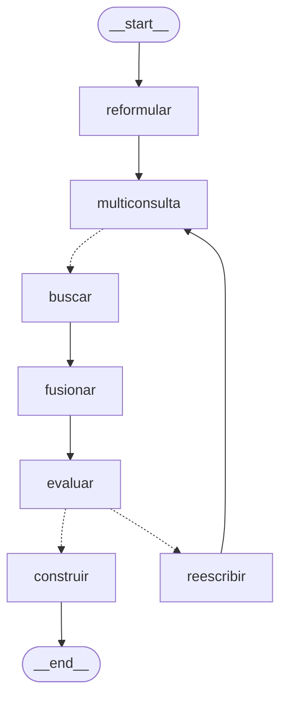

# Píldora 08 — El grafo agéntico de LangGraph

**Martes 3-nov-2026 · 20 min de lectura + 40 min de ejercicio**

## 0. Crítica de la entrega del día 07

No hay entrega del día 07: en `origin/aprendizaje` no existe `entregas/dia-07.md` y en el remoto no hay rama `ejercicio/dia-07`. Tampoco han llegado tarde la 02, la 03, la 04, la 05 ni la 06. Sin nota.

Hoy el ejercicio es corto y **no necesita Docker, ni modelos, ni clave de Gemini**: solo `uv sync` y pytest. Es buen día para retomar el ritmo. Y si un fin de semana recuperas el 07, encaja con lo de hoy: aquel arreglaba lo que verás en el log del Paso 4 (que el `Send` solo lleva la subconsulta).

`main` sigue en `fb93eea` (21-oct). Todo lo que sigue está comprobado hoy contra ese código y contra `langgraph 1.2.11`, la versión que fija `backend/uv.lock`. Las trazas y los tiempos que verás salen de ejecutar el grafo real con dobles en lugar de la búsqueda y del LLM.

---

## 1. Concepto clave: un grafo de estado en vez de una función larga

### 1.1 El problema

Un RAG "de libro" es una función: `buscar(pregunta) → prompt → LLM`. En cuanto quieres que el sistema **decida algo** (reformular si hay historial, partir una pregunta en dos, volver a buscar si lo encontrado es malo), esa función se llena de `if` y bucles, y deja de ser observable: no sabes por dónde pasó cada pregunta ni cuánto tardó cada paso.

LangGraph propone modelar el flujo como un **grafo de estado**:

- **Estado**: un diccionario compartido con un esquema (aquí, un `TypedDict`).
- **Nodos**: funciones `estado → actualización parcial`. Un nodo **no devuelve el estado entero**: devuelve solo las claves que cambia, y LangGraph las mezcla.
- **Aristas**: quién va después de quién. Fijas (`add_edge`) o condicionales (`add_conditional_edges`, una función que mira el estado y devuelve el nombre del siguiente nodo).
- **`compile()`**: valida el grafo y devuelve un objeto ejecutable con `invoke` (resultado final) y `stream` (una salida por paso).

### 1.2 Tres piezas que hay que entender bien

**Reductores.** Por defecto, si un nodo escribe una clave, **sustituye** el valor anterior. Si declaras la clave como `Annotated[list, funcion]`, LangGraph llama a `funcion(valor_actual, valor_nuevo)` y guarda el resultado. Sirve para acumular, y es imprescindible cuando **varios nodos escriben la misma clave en el mismo paso**: sin reductor, LangGraph lanza `InvalidUpdateError`, porque no sabe con cuál quedarse.

**`Send`.** Una arista condicional puede devolver, en vez de un nombre, una lista de `Send(nodo, carga)`. Cada `Send` lanza **una ejecución del nodo con esa carga como estado, y nada más**. Es el patrón *map-reduce*: N ramas en paralelo que luego se juntan en un nodo común. Lo que escriben las ramas vuelve al estado global a través de su reductor.

**Supersteps.** LangGraph ejecuta por pasos (modelo *Pregel*): en cada paso corren todos los nodos activos, en paralelo si son varios (los nodos síncronos van a un pool de hilos). Después se aplican sus escrituras y se decide qué nodos tocan en el paso siguiente. Hay un tope, `recursion_limit` (25 por defecto), para que un ciclo mal cerrado no gire para siempre.

### 1.3 "Agéntico", con matices

En la literatura, un *agente* es un LLM que decide qué herramienta usar en un bucle abierto. AGENT4U no es eso: es un **flujo fijo con dos decisiones tomadas por un LLM** (cómo reformular y en cuántas subconsultas partir) **y una tomada por un umbral numérico** (si reescribir). Es lo que a veces se llama *agentic RAG* o *corrective RAG*. No es un defecto: un flujo acotado es predecible, barato y fácil de probar. Pero conviene llamarlo por su nombre.

---

## 2. Cómo está en AGENT4U

### 2.1 El dibujo real

Este es el dibujo que devuelve `crear_grafo(...).get_graph().draw_mermaid()` sobre `main`, limpio de estilos y reordenado en el sentido del flujo (la salida completa la generarás tú en el Paso 2). Las flechas punteadas son aristas condicionales:



El dibujo no muestra que `multiconsulta -.-> buscar` puede ser **hasta tres** flechas a la vez (una por subconsulta) ni que el bucle `reescribir → multiconsulta` da como mucho dos vueltas. Eso está en el código.

### 2.2 La composición (`rag/grafo/grafo_create.py`, 27 líneas)

```python
def crear_grafo(dense_embedder, sparse_embedder, qdrant, cross_encoder, model):
    n = crear_nodos(dense_embedder, sparse_embedder, qdrant, cross_encoder, model)
    grafo = StateGraph(EstadoRAG)
    grafo.add_node("multiconsulta", n["multiconsulta"])   # ... los 7 nodos (:10-16)
    grafo.add_edge(START, "reformular")                                              # :18
    grafo.add_edge("reformular", "multiconsulta")                                    # :19
    grafo.add_conditional_edges("multiconsulta", n["repartir"], ["buscar"])          # :20
    grafo.add_edge("buscar", "fusionar")                                             # :21
    grafo.add_edge("fusionar", "evaluar")                                            # :22
    grafo.add_conditional_edges("evaluar", n["decidir"], ["reescribir", "construir"])  # :23
    grafo.add_edge("reescribir", "multiconsulta")                                    # :24
    grafo.add_edge("construir", END)                                                 # :25
    return grafo.compile()
```

Se compila **una vez**, en el arranque (`lifespan.py:64-70`), y queda en `app.state.grafo`. `POST /preguntar` lo recoge de ahí (`routers/query.py:114`). Las dependencias pesadas (los tres modelos de fastembed, el cliente de Qdrant y el nombre del modelo LLM) entran por **clausura**: `crear_nodos` las recibe una vez y los nodos las capturan. Por eso los nodos tienen la firma limpia `nodo(estado)` y el estado no lleva objetos de infraestructura.

El tercer argumento de `add_conditional_edges` (`["buscar"]`, `["reescribir", "construir"]`) es la lista de destinos posibles. LangGraph no la necesita para ejecutar, pero sin ella no puede dibujar la arista ni validar que el destino existe.

### 2.3 El estado (`grafo_nodes.py:7-24`)

```python
def acumular(actual: list | None, nuevo: list | None) -> list:
    if nuevo is None:
        return []                     # None es la señal de "vacía la lista"
    return (actual or []) + nuevo

class EstadoRAG(TypedDict, total=False):
    query: str                        # la pregunta original del usuario
    historial: list                   # objetos Mensaje de SQLAlchemy (últimos 6)
    max_fragmentos: int
    consulta_busqueda: str            # la pregunta "de trabajo": reformulada, luego reescrita
    chunks_parciales: Annotated[list[dict], acumular]   # lo que devuelven las ramas de buscar
    chunks: list[dict]                # lo que sale de fusionar: lo que verá el LLM
    intentos: int
    contexto_pobre: bool
    messages: list[dict]              # el prompt final
    subconsultas: list[str]
    valor_maximo: float
```

Fíjate en las dos listas de fragmentos. `chunks_parciales` tiene reductor porque **varias ramas de `buscar` escriben a la vez** en el mismo superstep. `chunks` no lo necesita porque solo la escribe `fusionar`. Y `acumular` tiene un truco: devolver `None` **vacía** la lista. Lo usa `reescribir` para que la segunda vuelta no arrastre los fragmentos de la primera.

`total=False` significa que ninguna clave es obligatoria. Por eso los nodos usan `estado.get(..., defecto)`, y por eso un error de nombre de clave no salta en ningún sitio: devuelve el valor por defecto en silencio. Así murió `max_fragmentos` (día 07).

### 2.4 Los nodos, uno a uno

| Nodo | Líneas | Qué hace | ¿Llama al LLM? |
|---|---|---|---|
| `reformular` | `:43-52` | Convierte la pregunta en autónoma usando el historial ("¿y por qué?" → "¿por qué el teorema CAP…?"). Pone `intentos = 0`. | Solo si hay historial (`generation.py:10-11`) |
| `multiconsulta` | `:28-35` | Pide al LLM que parta la pregunta en 1-3 subconsultas (prompt en `prompt.py:21-35`). Si el JSON no se puede leer, usa la pregunta tal cual (`generation.py:34-40`). | Siempre |
| `repartir` | `:37-41` | **No es un nodo**: es la función de la arista condicional. Devuelve un `Send("buscar", {"consulta_busqueda": s})` por subconsulta. | No |
| `buscar` | `:54-66` | `search_chunks` (día 07) y etiqueta cada fragmento con su subconsulta. | No |
| `fusionar` | `:107-133` | Agrupa por subconsulta, reparte un presupuesto de 9 a partes iguales, deduplica por texto y ordena por `score`. | No |
| `evaluar` | `:68-74` | `mejor_score = max(score)`; `contexto_pobre = mejor_score <= 0`. | No |
| `decidir` | `:88-95` | Arista condicional: `construir` salvo que el contexto sea pobre, `mejor_score >= -1` e `intentos < 2`. | No |
| `reescribir` | `:76-86` | Pide al LLM una consulta "claramente distinta", suma un intento y vacía `chunks_parciales` con `None`. | Siempre |
| `construir` | `:97-105` | Monta el prompt con `generate_query` (pregunta **original**, fragmentos e historial). No genera la respuesta: eso lo hace el streaming, fuera del grafo (día 09). | No |

La regla de `decidir`, despacio:

```python
if not estado.get("contexto_pobre"):     return "construir"   # mejor score > 0: suficiente
if estado.get("valor_maximo", 0) < -1:   return "construir"   # muy malo: no merece la pena
if estado.get("intentos", 0) >= 2:       return "construir"   # ya van dos reescrituras
return "reescribir"                                           # -1 <= mejor score <= 0
```

Solo se reescribe en una **franja estrecha**: el mejor logit del reranker entre -1 y 0. La lógica implícita es que, por encima de 0, hay algo relevante, y que por debajo de -1 la base documental probablemente no tiene la respuesta, así que reescribir solo gastaría dinero; mejor que el LLM diga *"No encuentro esa información"*. Por en medio, "casi": ahí una reformulación con sinónimos puede rescatar el fragmento.

### 2.5 Tres recorridos reales

Ejecuté el grafo compilado de `main` con dobles (búsquedas de 50 y 200 ms, LLM instantáneo) y `stream_mode="updates"`, que es lo que usa `query_service.py:74`:

```text
== contexto bueno (score 2,0), dos subconsultas
     7 ms  multiconsulta {'subconsultas': 2}
    58 ms  buscar        {'chunks_parciales': 10}     ← la rama rápida
   208 ms  buscar        {'chunks_parciales': 10}     ← la lenta; en paralelo, no 250 ms
   209 ms  fusionar      {'chunks': 8}                ← cuota 9 // 2 = 4 por rama
   209 ms  evaluar       {'contexto_pobre': False, 'valor_maximo': 2.0}
   210 ms  construir     {'messages': 1}

== contexto pobre (score -0,5): reescribe dos veces y se rinde
   206 ms  evaluar       {'contexto_pobre': True, 'valor_maximo': -0.5}
   206 ms  reescribir    {'consulta_busqueda': 'q (v2)', 'intentos': 1, 'chunks_parciales': None}
   ...     multiconsulta → buscar ×2 → fusionar → evaluar
   409 ms  reescribir    {'consulta_busqueda': 'q (v2) (v2)', 'intentos': 2, 'chunks_parciales': None}
   ...     multiconsulta → buscar ×2 → fusionar → evaluar
   613 ms  construir     {'messages': 1}

== contexto muy malo (score -3,0): no reescribe
   206 ms  evaluar       {'contexto_pobre': True, 'valor_maximo': -3.0}
   206 ms  construir     {'messages': 1}
```

Tres cosas que se ven aquí y no en el código:

1. Las ramas de `buscar` corren **en paralelo** (pool de hilos) y cada una emite su propio evento al terminar.
2. Cada vuelta del bucle son 5 supersteps (`reescribir`, `multiconsulta`, `buscar`, `fusionar`, `evaluar`). El peor caso necesita `recursion_limit = 17`: con el tope de 25 cabe, pero **solo hay margen para una vuelta más** (lo comprobé: con 15 y 16 lanza `GraphRecursionError`).
3. La segunda reescritura parte de la primera (`'q (v2) (v2)'`), no de la pregunta original.

### 2.6 De los nodos a la pantalla

`query_service.responder` (`:74-93`) recorre `grafo.stream(entrada, stream_mode="updates")`, rehace a mano las dos claves que necesita (`chunks` y `messages`) y emite un evento SSE `paso` por nodo con `datos_del_paso` (`:20-40`): cuántas subconsultas, cuántos fragmentos, el mejor score, el número de intento. El frontend los traduce a frases en `features/chat/LineaTiempoAgente.tsx` ("Descomponiendo en subconsultas", "Reescribiendo la consulta"…). Por eso el usuario ve progresar la pregunta en vez de una pantalla quieta. El backend manda hechos y el frontend pone las palabras; lo explica el docstring de `datos_del_paso`.

---

## 3. Por qué se montó así (y qué no cuadra)

### Decisiones

1. **LangGraph en vez de código Python a mano.** El flujo tiene un ciclo (reescribir y volver a buscar) y un *fan-out* paralelo (subconsultas). A mano, eso es un `while` con un `ThreadPoolExecutor` dentro y la instrumentación mezclada con la lógica. LangGraph da el paralelismo, el ciclo con tope y, sobre todo, `stream_mode="updates"`, que es lo que alimenta la línea de tiempo de la UI. *Coste:* una dependencia que cambia rápido (la API de `Send` y la de los reductores han cambiado entre versiones), una capa de indirección para depurar y comportamientos implícitos que hay que conocer (el estado de un `Send`, el `recursion_limit`). *Alternativas:* código a mano (más simple con un flujo tan fijo como este), LangChain LCEL (no tiene ciclos cómodos) o un framework de agentes (LlamaIndex, CrewAI), que habría sido matar moscas a cañonazos.

2. **Nodos como clausuras sobre las dependencias.** Las alternativas eran meter los modelos en el estado (no se pueden serializar y ensucian cada evento) o usar el `config` de LangGraph (`config["configurable"]`), que es más idiomático pero más verboso. La clausura es la opción más simple y hace los nodos fáciles de probar: `test_grafo_nodes.py:15` saca `fusionar` con `crear_nodos(None, None, None, None, None)`.

3. **Decisión por umbral numérico, no por LLM.** Un *corrective RAG* clásico pregunta al LLM "¿este contexto responde a la pregunta?". Aquí se usa el logit del reranker, que ya está calculado. *Ganancia:* cero llamadas extra y una decisión determinista y testeable. *Coste:* depende de la escala de un modelo concreto (Jina v2). Si cambias de reranker, los umbrales `0` y `-1` dejan de significar nada, y no están en `Settings` ni documentados.

4. **Multiconsulta con cuota por rama.** Una pregunta compuesta ("¿qué compromisos plantean la normalización y CAP?") busca mal como bloque: el vector queda a medio camino de los dos temas. Partirla da a cada tema sus propios candidatos, y la cuota de `fusionar` impide que el tema con logits más altos se quede con los 9 huecos. *Coste:* **una llamada al LLM en todas las preguntas**, incluso en las de un solo tema (que son la mayoría), antes de empezar a buscar. Es latencia pura hasta el primer fragmento.

5. **La generación fuera del grafo.** `construir` solo prepara `messages`; el streaming token a token lo hace `responder_stream` después. Así el grafo se puede ejecutar y probar sin tocar el LLM de generación. LangGraph tiene `stream_mode="messages"` para emitir tokens desde dentro de un nodo, pero habría acoplado el SSE al grafo.

### Cosas que no cuadran (comprobadas hoy contra `main`)

- 🔴 **Gana la última vuelta, no la mejor.** `fusionar` **sustituye** `chunks` en cada vuelta. Si la primera búsqueda saca un mejor score de -0,5 y la reescritura lo empeora a -2,0, `decidir` manda a `construir`… con los fragmentos de -2,0. Lo comprobé con dobles: `chunks finales: [... 'score': -2.0 ...] | valor_maximo: -2.0 | intentos: 1`. La reescritura puede **empeorar** el contexto, y el código no se queda con el mejor intento. Se arreglaría guardando en el estado el mejor `chunks` visto hasta el momento.

- 🟠 **La reescritura deriva.** `reescribir` parte de `consulta_busqueda`, que tras la primera vuelta ya es una reescritura. El prompt pide una consulta "claramente distinta" y "generalizar un poco", así que la segunda vuelta se aleja dos veces de lo que preguntó el usuario. Reescribir siempre desde la pregunta reformulada original, pasando los intentos fallidos como contexto, sería más estable.

- 🟠 **El campo `ms` del evento `paso` engaña con las ramas paralelas.** `query_service.py:89` mide el tiempo **desde el evento anterior**, no lo que tardó el nodo. En la traza de arriba, la rama lenta de `buscar` tardó 200 ms, pero su evento diría 150 (208 − 58). Con tres ramas, la UI enseña tres tiempos que no son la duración de ninguna. El log del ejercicio de hoy sí mide la duración real de cada nodo.

- 🟠 **Los umbrales `0`, `-1` y `2` intentos están escritos a mano**, sin nombre y sin documentar, igual que el `presupuesto = 9` del día 07. Y el tope de intentos está atado al `recursion_limit` sin que nada lo diga: si alguien sube los intentos a 4, el peor caso necesita 27 supersteps y la pregunta revienta con `GraphRecursionError` a mitad del SSE.

- 🟠 **Ningún test ejecuta el grafo compilado.** `test_grafo_nodes.py` prueba `acumular` y `fusionar` sueltos; `conftest.py:318` sustituye el grafo entero por `FakeGrafo`. El cableado (qué nodo va después de cuál, cuándo se reescribe, que el bucle termina) no lo comprueba nadie. Hoy escribes el primer test que lo hace.

- 🟡 **El README describe otro grafo.** En *Roadmap* (`README.md:434`) dice "decidir si recuperar, reformular query, autocrítica". El grafo **siempre** recupera, y no hay autocrítica de la respuesta: `evaluar` juzga los fragmentos, no lo que contesta el LLM. Además, el diagrama de *Arquitectura* no menciona el grafo, y la sección *Cómo funciona el pipeline* ni lo nombra.

- 🟡 **El estado lleva objetos ORM.** `historial` son instancias `Mensaje` de SQLAlchemy que viven después de cerrar la sesión. Funciona porque `db/session.py` crea las sesiones con `expire_on_commit=False` (si no, leer `m.rol` daría `DetachedInstanceError`), pero el grafo queda acoplado a la capa de persistencia. Pasar `[{"rol": ..., "contenido": ...}]` lo desacoplaría. Lo retomamos el día 10.

- 🟡 **`descomponer_consulta` protege el parseo, no la llamada.** El `try` (`generation.py:34-40`) envuelve el `json.loads`, pero no `litellm.completion`. Si Gemini devuelve un 429 en cualquiera de los nodos que llaman al LLM, la excepción sube desde dentro del grafo con el SSE ya empezado. El único `try` que emite un evento `error` es el de la generación (`streaming.py:50-64`), que va **después** del grafo, así que el cliente ve cortarse el stream sin explicación y la pregunta del usuario queda guardada sin respuesta (se guardó en `query_service.py:56`, antes de empezar). Lo vemos el jueves.

- 🟡 **Detalles menores.** El orden de `add_node` en `grafo_create.py` no sigue el flujo (empieza por `multiconsulta`), y en el diccionario de `crear_nodos` las claves no coinciden con los nombres de las funciones (`"reformular": nodo_reformular`, `"decidir": decidir_reconsulta`). Nada se rompe, pero cuesta leerlo.

---

## 4. Ejercicio (40 min): dibuja el grafo y haz que cada nodo deje rastro en el log

**Rama de código:** `ejercicio/dia-08`, creada desde `main`.
**Entrega:** `docs/aprendizaje/entregas/dia-08.md`, en la rama `aprendizaje`, **antes de las 8:30 del jueves 5-nov**.

Vas a: (1) dibujar el grafo de memoria y compararlo con el que genera LangGraph; (2) escribir **primero** un test que ejecuta el grafo compilado y comprueba el recorrido leyendo el log; (3) envolver cada nodo para que registre qué recibe, cuánto tarda y qué escribe. Sin Docker, sin modelos y sin clave.

### Paso 1 — Rama y punto de partida (3 min)

```bash
cd ~/ruta/AGENT4U
git fetch origin
git switch -c ejercicio/dia-08 origin/main
cd backend
uv sync
uv run pytest -q          # punto de partida: 91 passed
```

### Paso 2 — Dibuja de memoria y compara (7 min)

**Antes de mirar nada**, dibuja en la entrega (Mermaid o ASCII) el grafo tal como lo recuerdas de la sección 2: nodos, aristas y cuáles son condicionales. Después genera el real:

```bash
uv run python -c "
from app.rag.grafo.grafo_create import crear_grafo
print(crear_grafo(None, None, None, None, 'modelo').get_graph().draw_mermaid())"
```

Funciona con `None` porque construir el grafo no llama a nada: los nodos solo usan sus dependencias al ejecutarse. Pega la salida en la entrega y anota en qué te equivocaste.

### Paso 3 — El test primero, en rojo (10 min)

Crea `backend/tests/integration/test_grafo.py`:

```python
"""El grafo compilado de punta a punta, con dobles en lo que sale de proceso.

test_grafo_nodes.py prueba nodos sueltos; aquí se prueba el CABLEADO: qué
nodos se ejecutan, en qué orden y cuántas veces, según la calidad del contexto.
La búsqueda y el LLM se sustituyen con monkeypatch sobre el módulo
grafo_nodes, que es donde los nodos buscan esos nombres al ejecutarse.
"""
import logging
import re

import pytest

from app.rag.grafo import grafo_nodes
from app.rag.grafo.grafo_create import crear_grafo

CAMINO_CORTO = ["reformular", "multiconsulta", "buscar", "fusionar", "evaluar", "construir"]


@pytest.fixture
def montar(monkeypatch):
    """Devuelve una función que monta el grafo con dobles.

    scores: el score de los fragmentos en cada pasada (0 = primera búsqueda,
    1 = tras la primera reescritura...).
    """
    def _montar(scores, subconsultas=("tema",)):
        cuenta = {"reescribir": 0, "buscar": 0}

        def falsa_busqueda(consulta, *args, max_fragmentos=10, **kwargs):
            cuenta["buscar"] += 1
            score = scores[cuenta["reescribir"]]
            return [
                {"chunk": f"{consulta}-{i}", "score": score, "nombre": "doc.pdf",
                 "paginas": [1], "url": None, "headings": []}
                for i in range(3)
            ]

        def falsa_reescritura(consulta, model):
            cuenta["reescribir"] += 1
            return f"{consulta} (bis)"

        monkeypatch.setattr(grafo_nodes, "search_chunks", falsa_busqueda)
        monkeypatch.setattr(grafo_nodes, "descomponer_consulta", lambda consulta, model: list(subconsultas))
        monkeypatch.setattr(grafo_nodes, "reescribir_consulta", falsa_reescritura)
        monkeypatch.setattr(grafo_nodes, "generate_query", lambda q, chunks, h: [{"role": "user", "content": q}])
        return crear_grafo(None, None, None, None, "modelo-falso"), cuenta

    return _montar


def recorrido(caplog) -> list[str]:
    """Los nodos que terminaron, en orden, sacados de las líneas 'sale' del log."""
    return [
        re.match(r"nodo=(\w+) sale", r.getMessage()).group(1)
        for r in caplog.records
        if re.match(r"nodo=\w+ sale", r.getMessage())
    ]


def test_contexto_bueno_va_directo_a_construir(montar, caplog):
    caplog.set_level(logging.INFO, logger="app.rag.grafo")
    grafo, cuenta = montar(scores=[3.0])

    final = grafo.invoke({"query": "¿Qué es CAP?"})

    assert recorrido(caplog) == CAMINO_CORTO
    assert final["messages"] == [{"role": "user", "content": "¿Qué es CAP?"}]
    assert cuenta == {"reescribir": 0, "buscar": 1}


def test_contexto_pobre_reescribe_dos_veces_y_se_rinde(montar, caplog):
    caplog.set_level(logging.INFO, logger="app.rag.grafo")
    grafo, cuenta = montar(scores=[-0.5, -0.5, -0.5])

    grafo.invoke({"query": "¿Qué es CAP?"})

    pasos = recorrido(caplog)
    assert pasos.count("reescribir") == 2
    assert pasos.count("buscar") == 3
    assert pasos[-2:] == ["evaluar", "construir"]


def test_contexto_muy_malo_no_reescribe(montar, caplog):
    caplog.set_level(logging.INFO, logger="app.rag.grafo")
    grafo, cuenta = montar(scores=[-3.0])

    grafo.invoke({"query": "¿Qué es CAP?"})

    assert recorrido(caplog) == CAMINO_CORTO


def test_dos_subconsultas_abren_dos_ramas_que_solo_reciben_su_consulta(montar, caplog):
    caplog.set_level(logging.INFO, logger="app.rag.grafo")
    grafo, cuenta = montar(scores=[3.0], subconsultas=("tema A", "tema B"))

    grafo.invoke({"query": "¿A y B?", "max_fragmentos": 3})

    assert recorrido(caplog).count("buscar") == 2
    entradas_buscar = [r.getMessage() for r in caplog.records if r.getMessage().startswith("nodo=buscar entra")]
    # La lección del día 07, ahora visible en el log: el Send solo lleva la subconsulta.
    assert entradas_buscar == ["nodo=buscar entra claves=['consulta_busqueda']"] * 2
```

Dos detalles antes de lanzarlo:

- `monkeypatch.setattr(grafo_nodes, "search_chunks", ...)` funciona porque los nodos son clausuras que buscan `search_chunks` **en el módulo `grafo_nodes`** cada vez que se ejecutan. Si parchearas `app.rag.retrieval.search_chunks`, no pasaría nada: `grafo_nodes` ya importó su propia referencia.
- `reformular_consulta` no se parchea: sin historial devuelve la pregunta sin llamar al LLM (`generation.py:10-11`).

```bash
uv run pytest -q tests/integration/test_grafo.py
# esperado: 4 failed  (todavía no hay ningún log)
```

Pega el resumen. Si te sale algún test en verde, para y piensa por qué antes de seguir: un test que pasa sin el código que prueba no prueba nada. (Pista: es lo que pasaría con el tercero si comprobara solo `"reescribir" not in recorrido(caplog)`.)

### Paso 4 — Un envoltorio que registra cada nodo (10 min)

Sustituye **entero** `backend/app/rag/grafo/grafo_create.py` por:

```python
import logging
import time
from functools import wraps

from langgraph.graph import StateGraph, START, END
from app.rag.grafo.grafo_nodes import crear_nodos, EstadoRAG

logger = logging.getLogger(__name__)

NODOS = ("reformular", "multiconsulta", "buscar", "fusionar", "evaluar", "reescribir", "construir")


def registrar(nombre, nodo):
    """Envuelve un nodo: deja en el log qué claves recibe, cuánto tarda y qué escribe."""
    @wraps(nodo)
    def envuelto(estado):
        logger.info("nodo=%s entra claves=%s", nombre, sorted(estado))
        inicio = time.perf_counter()
        salida = nodo(estado)
        ms = (time.perf_counter() - inicio) * 1000
        logger.info("nodo=%s sale ms=%.0f escribe=%s", nombre, ms, sorted(salida or {}))
        return salida
    return envuelto


def registrar_ruta(nombre, ruta):
    """Lo mismo para las funciones de las aristas condicionales: qué camino eligen."""
    @wraps(ruta)
    def envuelta(estado):
        destino = ruta(estado)
        descripcion = destino if isinstance(destino, str) else f"{len(destino)} Send"
        logger.info("ruta=%s destino=%s", nombre, descripcion)
        return destino
    return envuelta


def crear_grafo(dense_embedder, sparse_embedder, qdrant, cross_encoder, model):
    n = crear_nodos(dense_embedder, sparse_embedder, qdrant, cross_encoder, model)

    grafo = StateGraph(EstadoRAG)

    for nombre in NODOS:
        grafo.add_node(nombre, registrar(nombre, n[nombre]))

    grafo.add_edge(START, "reformular")
    grafo.add_edge("reformular", "multiconsulta")
    grafo.add_conditional_edges("multiconsulta", registrar_ruta("repartir", n["repartir"]), ["buscar"])
    grafo.add_edge("buscar", "fusionar")
    grafo.add_edge("fusionar", "evaluar")
    grafo.add_conditional_edges("evaluar", registrar_ruta("decidir", n["decidir"]), ["reescribir", "construir"])
    grafo.add_edge("reescribir", "multiconsulta")
    grafo.add_edge("construir", END)

    return grafo.compile()
```

Por qué así:

- **Un decorador en la composición, no `logger.info` en cada nodo.** Los nodos siguen siendo lógica pura, y la instrumentación vive en un solo sitio. Es el mismo principio que separa `datos_del_paso` de los nodos.
- **`%s` con argumentos, no f-strings.** `logger.info("...%s", x)` solo formatea el mensaje si el nivel está activo.
- **Se registran las claves, no los valores.** Los valores incluyen fragmentos enteros y el historial de la conversación: ni caben en una línea de log ni deberían estar en los logs de producción.
- **`@wraps`** conserva el nombre y la firma de la función original. LangGraph inspecciona la firma de los nodos (por ejemplo, para saber si piden `config`), y así no lo engañas.

```bash
uv run pytest -q tests/integration/test_grafo.py      # 4 passed
uv run pytest -q tests/integration/test_grafo.py -o log_cli=true -o log_cli_level=INFO -k pobre
```

El segundo comando enseña el log en vivo. Pega en la entrega las líneas del test `pobre` y señala dos cosas: la línea donde `reescribir` escribe `chunks_parciales` (el log enseña la clave, no el valor: explica cómo sabes que es `None` y qué hace con él `acumular`) y la línea donde `decidir` pasa de `reescribir` a `construir`.

### Paso 5 (opcional, solo con modelos en caché y `APP_GEMINI_API_KEY`) — Míralo con la API de verdad

La app no configura `logging` en ningún sitio: `git grep -n "logging\." -- backend/app` solo encuentra tu fichero. Uvicorn configura sus propios loggers, pero no el raíz, así que un `logger.info` de `app.*` no sale por ningún lado. Para verlo sin tocar más código, pásale a uvicorn una configuración de logging:

```bash
cat > /tmp/agent4u-logging.json <<'EOF'
{
  "version": 1,
  "disable_existing_loggers": false,
  "formatters": {"simple": {"format": "%(asctime)s %(levelname)s %(name)s | %(message)s"}},
  "handlers": {"consola": {"class": "logging.StreamHandler", "formatter": "simple"}},
  "root": {"handlers": ["consola"], "level": "WARNING"},
  "loggers": {
    "app": {"level": "INFO"},
    "uvicorn": {"level": "INFO"}
  }
}
EOF
cd ~/ruta/AGENT4U && docker compose up -d qdrant
cd backend && uv run uvicorn app.api.main:app --port 8000 --log-config /tmp/agent4u-logging.json
```

En otra terminal, lanza una pregunta de un tema y otra de dos temas y compara, para las ramas de `buscar`, el `ms` del log con el `ms` del evento `paso`:

```bash
curl -sN -X POST localhost:8000/preguntar -H 'Content-Type: application/json' \
  -d '{"query": "¿Qué compromisos de diseño plantean la normalización relacional y el teorema CAP?"}' \
  | grep '"tipo": "paso"'
```

Si no tienes clave o modelos, sáltalo y dilo en la entrega.

### Paso 6 — Validar y subir (5 min)

```bash
cd ~/ruta/AGENT4U/backend
uv run pytest -q                  # 95 passed (91 + 4)
uv run ruff check app tests       # All checks passed!
cd ..
git add backend/app/rag/grafo/grafo_create.py backend/tests/integration/test_grafo.py
git diff --cached --stat          # 2 ficheros
git commit -m "feat(grafo): registro por nodo y primer test del grafo compilado"
git push -u origin ejercicio/dia-08
```

### Preguntas (responde con tus palabras en la entrega)

1. ¿Qué es un reductor en LangGraph? ¿Por qué `chunks_parciales` lo necesita y `chunks` no? ¿Qué error daría LangGraph si quitaras el `Annotated` y la pregunta se partiera en dos subconsultas?
2. ¿Para qué devuelve `reescribir` `"chunks_parciales": None`? Explica qué pasaría en la segunda vuelta si no lo hiciera, con la cuota de `fusionar` en la mano.
3. Explica la regla de `decidir` con tus palabras. ¿Por qué no se reescribe cuando el mejor score es -3? ¿Estás de acuerdo con esa decisión? ¿Qué harías con los umbrales?
4. ¿Cuántas llamadas al LLM hace, como mucho, una pregunta con historial que acaba reescribiéndose dos veces? Cuéntalas nodo a nodo, incluida la generación final. ¿Y una pregunta sin historial con buen contexto?
5. El 🔴 de la sección 3: ¿por qué gana la última vuelta y no la mejor? Propón un cambio concreto en el estado y en qué nodos lo tocarías (no hace falta implementarlo).
6. ¿Por qué el `ms` del evento `paso` no es la duración de la rama de `buscar`? ¿Por qué el `ms` de tu log sí lo es?
7. ¿Qué es `recursion_limit`? Si mañana quisieras permitir 4 reescrituras, ¿qué más tendrías que cambiar y dónde?
8. ¿Por qué `monkeypatch` tiene que parchear `grafo_nodes.search_chunks` y no `retrieval.search_chunks`?

### Criterios de aceptación

- [ ] Rama `ejercicio/dia-08` en el remoto, creada desde `main` (`git merge-base --is-ancestor origin/main origin/ejercicio/dia-08`).
- [ ] Paso 2: tu dibujo de memoria **y** la salida de `draw_mermaid()`, con tus errores anotados.
- [ ] Paso 3: resumen de pytest con `4 failed` **antes** de tocar `grafo_create.py`.
- [ ] Paso 4: `4 passed` y las líneas de log del test `pobre`, con la escritura de `chunks_parciales` y el cambio de ruta señalados.
- [ ] `uv run pytest -q` → `95 passed` y `uv run ruff check app tests` limpio (pega los resúmenes).
- [ ] `git diff --stat origin/main origin/ejercicio/dia-08` muestra solo los 2 ficheros del Paso 6.
- [ ] Paso 5 hecho o, si no tienes clave o modelos, dicho explícitamente.
- [ ] Las 8 preguntas respondidas con tus palabras.
- [ ] Párrafo para `ARCHITECTURE.md` al final de la entrega.

Entrega (antes de las 8:30 del **jueves 5-nov**):

```bash
git switch aprendizaje && git pull
cp docs/aprendizaje/entregas/PLANTILLA.md docs/aprendizaje/entregas/dia-08.md
# ...rellena dia-08.md: dibujo y mermaid, resúmenes de pytest y ruff, líneas de log, respuestas y párrafo...
git add docs/aprendizaje/entregas/dia-08.md
git commit -m "entrega día 08" && git push
```

Si quieres feedback antes de entregar, pega `docs/aprendizaje/PROMPT_REVISION.md` en Claude Code con `XX = 08`, estando en tu rama `ejercicio/dia-08`.

---

## 5. Para profundizar (opcional)

- LangGraph, *Graph API* (estado, reductores, `Send`, aristas condicionales y `recursion_limit`): https://docs.langchain.com/oss/python/langgraph/graph-api
- LangGraph, *Streaming* (`updates`, `values`, `messages` y qué emite cada uno): https://docs.langchain.com/oss/python/langgraph/streaming

## 6. Aportación a `ARCHITECTURE.md`

Tu párrafo para la sección *6. El grafo agéntico* debería cubrir:

- El dibujo de los 7 nodos y las dos aristas condicionales, con el *fan-out* de `repartir` y el bucle de reescritura.
- Qué es "agéntico" aquí y qué no: dos decisiones de LLM (reformular, descomponer) y una por umbral (reescribir).
- El estado: qué clave escribe cada nodo, por qué `chunks_parciales` tiene reductor y el truco del `None`.
- La regla de `decidir` (franja `-1 <= score <= 0`, dos intentos como mucho) y su dependencia de la escala del reranker.
- El coste: llamadas al LLM por pregunta (mínimo y máximo) y la latencia de `multiconsulta` en todas las preguntas.
- Cómo se observa: eventos `paso` en el SSE para la UI y, tras tu cambio, el log por nodo con su duración real.
- Los huecos abiertos: gana la última vuelta, la deriva de la reescritura, los umbrales sin nombre y su relación con `recursion_limit`.

**El jueves 5-nov (día 09):** lo que pasa después de `construir`. El prompt de sistema y cómo se arma el contexto (`prompt.py`), LiteLLM como capa entre AGENT4U y Gemini, y el streaming SSE de `/preguntar`: el formato de cada evento (`inicio`, `paso`, `fuentes`, `texto`, `fin` y `error`), quién guarda la respuesta en la base de datos y qué pasa si el LLM falla a mitad. Llamarás a `/preguntar` con `curl -N` e identificarás cada tipo de evento.
